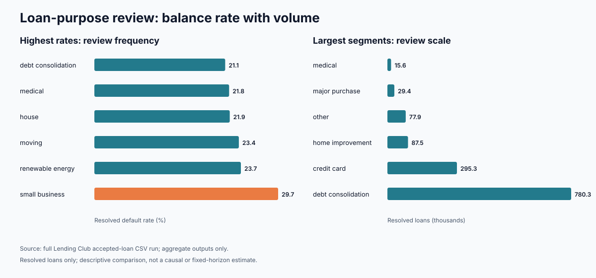

# Full-data portfolio review: where should an analyst investigate first?

**Decision supported:** prioritize follow-up portfolio analysis, not approve or
reject applicants. **Audience:** risk/product analyst and business stakeholders.
**Evidence:** verified full-data runs through both the Python/SQLite baseline and the
dbt + DuckDB workflow; only aggregate evidence is retained in this report directory.

## Portfolio and data quality

The source contained 2,260,701 records. The runner loaded 2,260,668 loans and
rejected 33 non-loan summary records embedded between source-file sections (32
"Total amount funded" lines and one section label). The reconciliation is exact,
with no duplicate IDs, missing interest rates, missing FICO lower bounds or unknown
grade/purpose/state values among loaded loans.

Of the loaded loans, 1,345,350 (59.51%) have a resolved status under the documented
definition. There are 268,599 Charged Off or Default loans, producing a 19.96%
resolved default rate. The remaining 915,318 records are retained for coverage but
excluded from that denominator. This includes 878,317 Current loans and smaller
late/grace-period or policy-code status groups, so the rate is not a fixed-horizon
default estimate.

## Findings and proposed actions

| Full-data observation | Business interpretation | Proposed next step |
|---|---|---|
| Small-business purpose: 4,580 defaults / 15,416 resolved = 29.71% | Highest purpose rate, but only 1.70% of observed defaults | Compare within grade, term and vintage before considering policy changes |
| Debt consolidation: 165,035 defaults / 780,342 resolved = 21.15% | 36.0× as many observed defaults as small business despite a lower rate | Put this segment first for scale-oriented investigation |
| Mississippi: 1,718 / 6,588 = 26.08%; California: 38,541 / 196,529 = 19.61% | Mississippi leads state rate; California has 22.4× its observed defaults | Use both count and rate, then control for portfolio mix |
| Grade risk rises monotonically from A (6.04%) to G (49.93%) | Strong descriptive ordering, but grade is an existing risk classification | Use for monitoring and stratification, not as independent causal evidence |
| Grade B, 2015→2016: 13.03%→16.11% (+3.08 pp) | The historical vintage signal is reproduced | Do not call deterioration without comparable outcome coverage |

Keep the two scale comparisons distinct: debt consolidation has 780,342 / 15,416
= **50.6× the resolved-loan count** of small business, but 165,035 / 4,580 =
**36.0× the observed-default count**. The first describes segment population; the
second describes the number of observed defaults. Neither is a dollar-loss ratio.

The most important coverage warning is visible in grade B: resolved share falls
from 90.91% in 2015 to 66.17% in 2016, 35.31% in 2017 and 10.78% in 2018. The
2018 resolved default rate of 11.72% therefore should not be read as an improvement
over mature vintages.

## Difference from the saved historical results

The historical purpose, state and grade-B cohort rates reproduce exactly after
rounding because both analyses use the same exact-status resolved population. The
new run changes the strength of the evidence rather than the headline rates:

- It verifies the complete input and reconciles the notebook's 2,260,701 source
  records to 2,260,668 actual loans plus 33 embedded summary records.
- It replaces rate-times-count approximations with exact observed default counts.
  For example, debt consolidation has 165,035 defaults versus 4,580 for small
  business; the earlier 50.6× comparison was resolved-loan volume, while the exact
  default-count ratio is 36.0×.
- It expands the historical top-15 state-rate excerpt to all states. California,
  omitted from that excerpt because its 19.61% rate is lower, is the largest state
  default-count contributor (38,541), ahead of New York (24,220), Texas (21,842)
  and Florida (20,536).
- It adds accepted-loan counts and resolved-share diagnostics. These show why recent
  vintage comparisons are particularly vulnerable to incomplete outcomes.

No contradiction with the historical saved tables was found. Small last-digit
differences are display rounding only.

## Evidence trail and boundaries

- Aggregate full-run outputs: [portfolio](full/01_portfolio.csv),
  [segments](full/02_segments.csv), [cohorts](full/03_cohorts.csv),
  [status coverage](full/status_coverage.csv) and [manifest](full/manifest.json).
- The [dbt workflow](../../docs/dbt_workflow.md) independently reproduces these
  portfolio, segment and cohort aggregates and documents its 39 full-data tests.
- Historical extracts remain in [historical](historical/) for comparison.
- The source digest in the full-run manifest is
  `3eae03c28fd9d2e8a076ebeb73507e8d4d0f44d90500decdb0936e0933d1f36a`.
- The original CSV and the 81,111-row loan-level pricing-review output remain outside
  the aggregate evidence set and are excluded from version control.
- All findings are descriptive. They do not establish causality, expected loss,
  fair-lending compliance, or a production underwriting rule.
